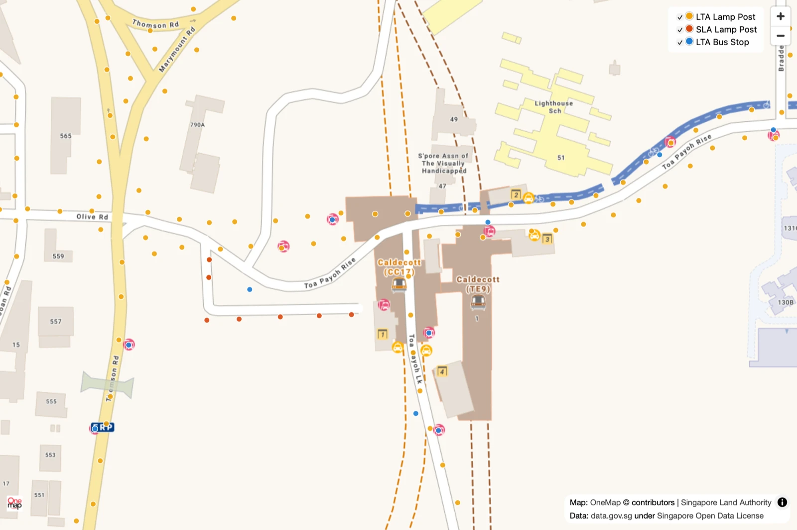

<h1 align="center">SG Street Points</h1>

<p align="center">An interactive web map of Singapore's lamp posts and bus stops.</p>

<p align="center"><a href="https://flamanta.github.io/sg-streetpoints/"><u>Try it in your browser</u></a>&emsp;<a href="https://github.com/flamanta/sg-streetpoints/releases"><u>Release notes</u></a>&emsp;<a href="https://github.com/flamanta/sg-streetpoints/issues"><u>Issues</u></a></p>

<div align="center">

[](https://github.com/flamanta/sg-streetpoints/releases/latest) [](https://github.com/flamanta/sg-streetpoints/actions/workflows/refresh.yml) [](LICENSE) [](https://doi.org/10.5281/zenodo.24074189)

</div>

<p align="center"></p>

## Why I created the map

Lamp posts and bus stops are everywhere. Before Google Maps, people used them as landmarks. Today they fade into the background.

This map brings them back into view: more than 100,000 lamp posts packed onto one small island. Zoom into your own street and see how many you have walked past without noticing.

## Using the map

The zoomed-out view shows one card per region with the counts of lamp posts and bus stops. Individual points appear from zoom 15. Click a card to zoom in, and click a point for its details. Add `?debug` to the address to see the zoom level, the number of points on screen and any errors.

## How it works

1. `scripts/fetch_geojson.py` downloads each dataset through the data.gov.sg API and skips the run if nothing has changed.
2. `scripts/inject_latlon.py` writes slimmed GeoJSON with `lat` and `lon` properties to `data/`.
3. `scripts/make_regions.py` counts the points of each type in five regions, for the zoomed-out view.
4. `scripts/build_site.py` assembles the site: it copies `web/index.html` and the data, downloads a pinned MapLibre GL JS (checked against a SHA-256), and calls `scripts/build_tiles.py`, which turns the LTA lamp posts into vector tiles with tippecanoe and checks that none are missing.
5. The workflow in `.github/workflows/refresh.yml` runs monthly, or on demand, and deploys the map to GitHub Pages.

Dataset IDs and the properties kept for each layer are set in `config/datasets.json`. An optional `DATA_GOV_SG_API_KEY` repository secret raises the API rate limits.

### Running it locally

Install tippecanoe (`brew install tippecanoe`), run `python3 scripts/build_site.py`, then serve the `site/` folder, for example with `python3 -m http.server --directory site`. Opening `site/index.html` straight from disk does not work, because the page loads its data with `fetch`.

## Data sources and attribution

Contains information from the datasets below, accessed from [data.gov.sg](https://data.gov.sg), which is made available under the terms of the [Singapore Open Data Licence v1.0](https://data.gov.sg/open-data-licence).

| Dataset | Agency |
|---|---|
| [LTA Lamp Post](https://data.gov.sg/datasets/d_ca109de3e83efdd9a10bc5f3dda70a98/view) | Land Transport Authority |
| [SLA Lamp Post](https://data.gov.sg/datasets/d_1ad7921e25264140dc361e193c095c52/view) | Singapore Land Authority |
| [LTA Bus Stop](https://data.gov.sg/datasets/d_3f172c6feb3f4f92a2f47d93eed2908a/view) | Land Transport Authority |

The data is retrieved monthly, so the access date is the date of the latest workflow run. Point locations in the lamp post datasets are indicative only, as stated by the data owners.

The background map is [OneMap](https://www.onemap.gov.sg/), © contributors, Singapore Land Authority, used under the [OneMap terms of use](https://www.onemap.gov.sg/legal/termsofuse.html).

This project is not endorsed by or affiliated with LTA, SLA or the Singapore Government.

## License

The code in this repository is released under the [MIT License](LICENSE). The data is not covered by it: it remains under the [Singapore Open Data Licence v1.0](https://data.gov.sg/open-data-licence), and the OneMap basemap under the OneMap terms of use.

## Citation

To cite this project, use the DOI badge at the top (it always points to the latest version), or the metadata in [`CITATION.cff`](CITATION.cff).

### APA

Cher, W. M. (2026). *sg-streetpoints: Interactive web map of Singapore's lamp posts and bus stops* [Computer software]. Zenodo. https://doi.org/10.5281/zenodo.24074189

### BibTeX

```bibtex
@misc{cher_sg_streetpoints,
  author    = {Cher, Wei Min},
  title     = {{sg-streetpoints: Interactive web map of Singapore's lamp posts and bus stops}},
  year      = {2026},
  publisher = {Zenodo},
  doi       = {10.5281/zenodo.24074189},
  url       = {https://doi.org/10.5281/zenodo.24074189}
}
```
